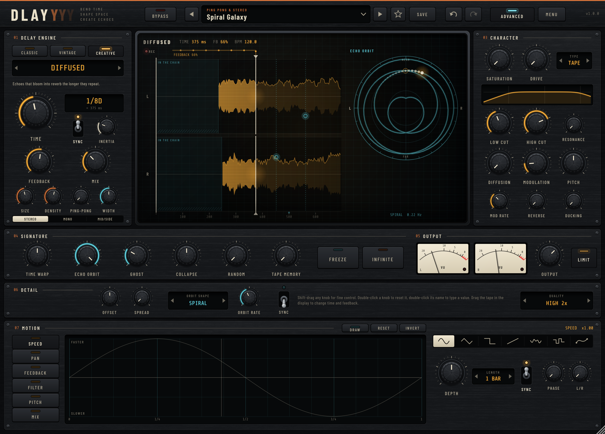
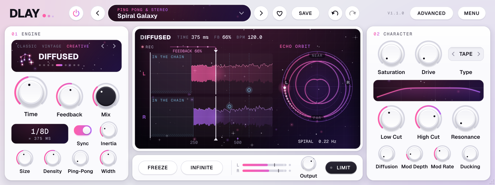
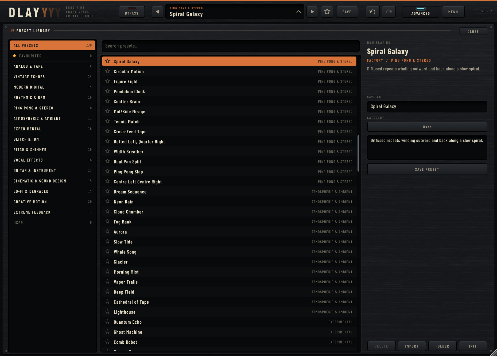

# DLAY

**Bend Time. Shape Space. Create Echoes.**

DLAY is a creative multi-engine delay plug-in (VST3 / AU / Standalone) written in C++20 with
[JUCE](https://juce.com). It combines 21 delay algorithms, a drawable modulation system
(MOTION), seven signature features and a live picture of the delay's tape loop in one
instrument.



| Compact view | Preset library |
|---|---|
|  |  |

---

## Contents

- [Quick start](#quick-start)
- [What is in the box](#what-is-in-the-box)
- [Building](#building)
- [Tests and tools](#tests-and-tools)
- [Using DLAY](#using-dlay)
- [Algorithms](#algorithms)
- [Signal flow](#signal-flow)
- [Source layout](#source-layout)
- [Presets](#presets)
- [Engineering notes](#engineering-notes)
- [Verification status](#verification-status)
- [Licences](#licences)

---

## Quick start

```bash
cmake -S . -B build -DCMAKE_BUILD_TYPE=Release
```

```bash
cmake --build build --config Release --parallel 4
```

The first configure downloads JUCE 9.0.5. Give `--parallel` a number that suits your
machine: without one, `make` starts every compile at once and can run a small machine out
of memory. The plug-ins are written to
`build/DLAY_artefacts/Release/` (`VST3/DLAY.vst3`, `AU/DLAY.component` on macOS,
`Standalone/DLAY`). Copy them to your plug-in folder, or configure with
`-DDLAY_COPY_PLUGIN=ON` to have the build do it.

### Installing

Copy the built plug-in to the folder your DAW scans, then rescan:

| System | VST3 | Audio Unit |
|---|---|---|
| Windows | `C:\Program Files\Common Files\VST3\` | - |
| macOS | `~/Library/Audio/Plug-Ins/VST3/` | `~/Library/Audio/Plug-Ins/Components/` |
| Linux | `~/.vst3/` | - |

`DLAY.vst3` is a folder: copy all of it. DLAY shows up as an effect from "DLAY Audio" in the
delay category. Put it on a track or a send, pick a preset, turn MIX. The Standalone build
runs without a DAW.

## What is in the box

| | |
|---|---|
| **21 algorithms** | Classic: Digital, Stereo, Ping-Pong (pattern bouncer), Dual, Multi-Tap, Slapback. Vintage: Tape, BBD, Tape Echo (3 heads), Warm Analog, Degraded, Lo-Fi. Creative: Reverse, Granular, Pitch, Spectral, Diffused, Glitch, Fractal, Random, Shimmer. |
| **MOTION** | Six modulation lanes (speed, pan, feedback, filter, pitch, mix). Each is an LFO (sine, triangle, square, saw, smooth random, sample & hold) or a curve you draw, with its own depth, rate or tempo length, phase and left/right offset. |
| **Signature features** | TIME WARP, ECHO ORBIT, GHOST MODE, TIME COLLAPSE, INFINITE UNIVERSE, RANDOM UNIVERSE, TAPE MEMORY, plus a loss-free FREEZE. |
| **Feedback path** | Filters with resonance, five saturation types (2x / 4x oversampled), diffusion, modulation, pitch shifting, reverse, ducking, and protection that keeps the loop bounded whatever you do. |
| **Echo visualizer** | The engine's real tape: sound enters at the REC head, travels to the PLAY heads and returns along the feedback rail. Every tap, bounce, ghost, grain and slice is drawn where the engine is reading. Drag it to change time and feedback. |
| **Presets** | 239 factory presets in 15 categories, search, favourites, previous/next, user presets as plain files. |
| **Interface** | Resizable (60 % - 200 %), compact and advanced views, tooltips on everything, undo/redo. |

## Building

### Requirements

| Platform | Needs |
|---|---|
| **Windows** | Visual Studio 2022 (C++ workload), CMake 3.22+ |
| **macOS** | Xcode 14+, CMake 3.22+. Builds a universal (arm64 + x86_64) VST3, AU and Standalone |
| **Linux** | GCC 11+ or Clang 14+, CMake 3.22+, and the JUCE dependencies listed below |

Linux packages (Debian / Ubuntu):

```bash
sudo apt-get install build-essential cmake ninja-build libasound2-dev libx11-dev libxext-dev libxrandr-dev libxinerama-dev libxcursor-dev libxrender-dev libxcomposite-dev libxi-dev libfreetype-dev libfontconfig1-dev libgl1-mesa-dev libegl-dev
```

### Options

| Option | Default | Meaning |
|---|---|---|
| `DLAY_JUCE_TAG` | `9.0.5` | JUCE version to fetch |
| `DLAY_JUCE_PATH` | *(empty)* | Use an existing JUCE checkout instead of fetching |
| `DLAY_COPY_PLUGIN` | `OFF` | Install the built plug-ins into the user plug-in folders |
| `DLAY_BUILD_TESTS` | `ON` | Build `DLAY_Tests` and `DLAY_UiSnapshot` |
| `DLAY_BUILD_HOST_CHECK` | `OFF` | Build `DLAY_HostCheck`, a small VST3 host that validates the built plug-in |
| `DLAY_ENABLE_LTO` | `OFF` | Link-time optimisation |
| `DLAY_SANITIZE` | *(empty)* | `address` (AddressSanitizer + UBSan) or `thread` (ThreadSanitizer) for the whole build, JUCE included. For running `DLAY_Tests`, not for releases. GCC / Clang |

A GitHub Actions workflow (`.github/workflows/build.yml`) builds and tests all three
platforms on every push and offers one archive per system (plug-ins, standalone and
`INSTALL.txt`) under the run's *Artifacts*. Pushing a tag such as `v1.0.0` also publishes
the archives on the repository's Releases page.

## Tests and tools

| Tool | What it does |
|---|---|
| `DLAY_Tests` | Headless DSP and plug-in tests: filter and interpolator accuracy, sample-exact echo timing, block-size independence, every algorithm at 44.1 - 192 kHz, "feedback below 100 % always decays", runaway-feedback protection, loss-free freeze, pitch accuracy and pitch sweeps, resets (nothing of the old tape comes back, and what an erase costs), values that are not numbers in parameters, transport, audio and sessions, bus layouts, bypass, state recall (also from a thread that is not the message thread), and the whole preset library (each preset rendered and compared with every other). `--quick` skips the long renders, `--perf` prints the CPU cost per algorithm, `--demo <dir>` renders a short musical phrase through a selection of presets, `--render <dir>` renders every factory preset. |
| `DLAY_UiSnapshot <dir>` | Runs the real editor with audio flowing and writes PNG screenshots. With `--interact` it also drives the interface with simulated mouse gestures and checks the results. Needs a display; use `xvfb-run` on a headless Linux machine. |
| `DLAY_HostCheck <DLAY.vst3>` | Loads the built VST3 through JUCE's hosting code, like a DAW: scan, parameters, processing at several rates and block sizes, state through the VST3 stream, and the editor open while audio runs on another thread. |

```bash
ctest --test-dir build --output-on-failure
```

## Using DLAY

**The top bar** has the preset display (click it for the library), previous / next,
favourite, save, undo / redo, the ADVANCED view switch and the settings MENU (saturation
quality, "keep MIX when changing presets", window size, preset folder).

**Delay engine (left).** Pick a family and an algorithm. TIME is a note value when SYNC is
on and milliseconds when it is off. Each algorithm has two controls of its own (the two
orange knobs; their names change with the algorithm). PING-PONG throws the input to one
side and crosses the feedback; the switch below chooses STEREO, MONO or MID/SIDE operation.

**Character (right).** SATURATION and DRIVE with five characters, the feedback filters with
a live response display, DIFFUSION, MODULATION, PITCH, REVERSE and DUCKING.

**Signature (below).**

| Control | What it does |
|---|---|
| TIME WARP | Bends time from 4x slower to 4x faster with tape-style pitch glides (INERTIA sets how heavy the flywheel is) |
| ECHO ORBIT | Sends the echoes along a path through the stereo field: circle, figure 8, pendulum, spiral or scatter. The far side of the orbit is quieter and darker |
| GHOST | Faint, band-passed, slowly detuning apparitions of earlier repeats, with their attacks removed, drifting across the stereo field |
| COLLAPSE | Adds echoes that get closer and closer together (right, a bouncing ball) or further apart (left) |
| RANDOM | On every cycle nudges time, position, filter and feedback by a controlled random amount |
| TAPE MEMORY | Wears out the tape: wow, flutter, drifting speed, dull highs, dropouts and saturation, on any algorithm |
| FREEZE | Holds the tape loss-free for as long as you like; all the readers keep working, so you can still warp, orbit and collapse it |
| INFINITE | The loop sustains for ever at a controlled level while still taking in new sound |

**MOTION (advanced view).** Choose a lane on the left, a shape on the right. Click in the
curve to add a point, drag to move it, double-click to remove it, Alt-drag a segment to bend
it, hold Shift to snap. Switch DRAW on to paint freehand. Editing an LFO lane turns it into
a custom curve that starts out as that LFO. The filled area is what reaches the engine
after DEPTH; the bright trace is what the lane really did on its last pass.

| Lane | At 100 % depth | Notes |
|---|---|---|
| SPEED | echoes twice as fast / half as fast | glides like tape; INERTIA sets how heavily |
| PAN | full left to full right | with an L/R offset the two sides converge and diverge: width modulation |
| FEEDBACK | +/- 50 % feedback | |
| FILTER | 6 octaves | works like a DJ filter: down closes the low-pass, up opens the high-pass |
| PITCH | +/- 12 semitones | engages the pitch shifter in the loop |
| MIX | the whole MIX range | rides the echo level only; the dry signal is never touched |

Synced lanes follow the song position while the transport runs, so the same bar always
gets the same motion.

**Everywhere:** Shift-drag for fine control, double-click a knob to reset it, double-click
its name to type a value (`350`, `1.2 s`, `2.5k`, `x2`...).

## Algorithms

The two orange knobs are specific to each algorithm:

| Algorithm | A | B | Character |
|---|---|---|---|
| Digital | COLOR (centre pristine; left band-limits like an early digital unit, right adds low-resolution grit) | TILT (darker / brighter repeats) | Sample-accurate, flat |
| Stereo | R RATIO (right time as a musical ratio) | TILT | Independent left and right times |
| Ping-Pong | PATTERN (L-R, L-C-R-C, L-R-C, L-L-R-R, L-R-R-L, C-L-C-R) | ANGLE | Pattern bouncer |
| Dual | B RATIO | BALANCE | Two delays, A left and B right |
| Multi-Tap | TAPS (2 - 8) | SHAPE (fading / flat / swelling) | The pattern repeats through the feedback |
| Slapback | SNAP | DOUBLER | Short, punchy single repeat |
| Tape | WOW/FLT | AGE | Head bump, soft saturation, speed-dependent tone |
| BBD | STAGES (512 - 16384) | CLOCK | Darker the longer the delay, like the real chips |
| Tape Echo | HEADS (7 combinations) | WOW/FLT | Three-head echo unit |
| Warm Analog | WARMTH | DRIFT | Melts and self-oscillates gracefully |
| Degraded | LOSS | DUST | Every repeat is a worse copy of the last |
| Lo-Fi | BITS | RATE | Early-sampler echo |
| Reverse | SMOOTH | SWELL | REVERSE sets how much feedback is re-reversed |
| Granular | GRAIN | SPRAY | A cloud of grains around the delay time |
| Pitch | DETUNE | WINDOW | Every repeat climbs or falls |
| Spectral | TILT (disperse) | SMEAR | Each frequency band has its own delay |
| Diffused | SIZE | DENSITY | Echoes that bloom into reverb |
| Glitch | SLICE | CHAOS | Stutter, reverse, speed jumps, tape-stops, gates |
| Fractal | DEPTH (2 - 6 scales) | RATIO | Echoes inside echoes |
| Random | CHAOS | QUANTIZE | Taps that land somewhere new every cycle |
| Shimmer | SHIMMER | SIZE | Pitched, diffused feedback |

## Signal flow

```
                         +---------------- feedback (matrix: straight <-> crossed) ---------------+
                         |                                                                        |
 in --> stereo mode --> drive --> (+) --> diffusion --> pitch --> spectral --> filters --> character --> saturation --> protection --> TAPE
                                                                                                                                       |
                                                                                             readers: taps / heads / reverse / grains / slices,
                                                                                             TIME COLLAPSE taps, GHOST voices
                                                                                                                                       |
 dry ------------------------------------------------------------+        width --> ECHO ORBIT + MOTION pan --> ducking <--------------+
                                                                 |                                   |
                                                                 +--------------> mix <--------------+--> output gain --> limiter --> out
```

Sound is processed on the way *onto* the tape, and every algorithm is a different way of
reading it back. Because of that all readers - including the GHOST, COLLAPSE and REVERSE
layers - hear the same coloured tape, and FREEZE is simply a loss-free recirculation of
what is already there.

## Source layout

```
Source/
  PluginProcessor.*        JUCE processor: buses, transport, state
  PluginEditor.*           window, layout, scaling, top bar
  Params/                  parameter ids, layout, value formatting, mode tables
  DSP/
    DlayEngine.*           the engine (control-rate update + per-sample loop)
    DelayLine.h            circular buffer, Hermite and band-limited sinc reads
    Oversampler.h          polyphase IIR half-band up/down samplers
    Saturation.h           shapers and loop protection
    Filters.h              TPT state-variable filter, one-poles, biquads
    Diffuser.h             glide-able all-pass chains
    PitchShifter.h         two-head shifter with correlation splice alignment
    SpectralProcessor.h    STFT per-bin delay
  Motion/                  MOTION lanes and curve model
  Presets/                 preset manager and factory library
  UI/                      theme, controls, echo visualizer, MOTION editor, preset browser
Tests/                     test runner, UI snapshot tool, host validator
Assets/Fonts/              embedded typefaces (SIL OFL)
```

## Presets

A preset is the complete sound: every parameter except the session settings (bypass,
quality) plus the six MOTION curves. User presets are small XML files
(`*.dlaypreset`) in:

| Platform | Folder |
|---|---|
| Windows | `%APPDATA%\DLAY Audio\DLAY\Presets` |
| macOS | `~/Library/Application Support/DLAY Audio/DLAY/Presets` |
| Linux | `~/.config/DLAY Audio/DLAY/Presets` |

Copy them to share them; IMPORT in the library copies a file into the folder.

## Engineering notes

- **Real-time safety.** No allocation, no blocking and no system calls in the audio
  callback. All buffers are sized in `prepareToPlay`. Parameters are read through atomics;
  the custom MOTION curves are a table of atomics; telemetry for the display is lock-free.
  The one lock anywhere on the audio path is inside JUCE: its portable FFT (used by the
  SPECTRAL algorithm on Windows and Linux; macOS uses vDSP) takes a spin lock that belongs
  to the FFT object. Every channel has its own FFT and only the audio thread uses it, so
  the lock is never contended; its scratch memory is on the stack.
- **Erasing costs the same at every sample rate.** A preset change, a host reset and
  waking up from bypass all have to empty the delay memory - 7 MB at 48 kHz, 29 MB at
  192 kHz. Nothing is zero-filled in one go. The tape and the pitch-shifter lines are
  marked stale in 4 kB blocks; a stale block is cleared the first time a read or a write
  touches it, and the rest is swept in the background within about 45 ms. The diffusers
  and the spectral history only count what has been stored since. What a read returns is
  exactly what a zero-filled memory would have returned, so a host reset is instant: no
  old tail, and the next note is echoed from its first sample.
- **Click-free.** Every gain is ramped per sample; delay-time changes glide through a
  two-pole "flywheel"; algorithm and preset changes fade the wet signal out, rebuild, and
  fade back in; bypass is a crossfade. What is heard directly - the dry level, OUTPUT and
  the bypass crossfade - is smoothed separately from the loop: a reset empties the tape but
  never makes those jump. The pitch shifter's two read heads each keep their own position
  and travel at the current ratio, so a pitch sweep (the PITCH lane, automation) bends
  their path instead of making them jump.
- **Containment.** Parameter values and the host's transport pass through one function
  that forces them into range before the engine uses them, and MOTION curve points are
  repaired when they are read. A value that is not a number - from a damaged session, or a
  host reporting NaN for the song position - can therefore not settle in a smoother or a
  filter. Should one ever arise inside the loop it is kept off the tape and out of the
  output, and the loop starts again from silence.
- **Threads.** Hosts restore a session from whichever thread suits them. Away from the
  message thread the state is only parsed and handed over; the parameter tree, the curves,
  the preset name and the undo history are replaced on the message thread. Until that has
  happened, the waiting state is what `getStateInformation` reports.
- **Interpolation and aliasing.** The main tap uses a 16-point windowed-sinc kernel whose
  cut-off follows the read speed, so time warps and pitch shifts do not alias. When nothing
  is modulating, the delay snaps to whole samples so repeats stay perfectly flat.
- **Latency-compensated chain.** Diffusion, the pitch shifter, the STFT and the
  oversamplers all add delay inside the loop; the main tap subtracts it, so echoes land on
  time whatever is switched on. Plug-in latency is zero.
- **Feedback below 100 % always decays.** Nothing inside the loop is allowed to add gain:
  saturators have unity small-signal gain, the resonant filters are normalised so their
  combined peak sits at unity (the resonant band is simply the one that decays last), the
  tape head bump is applied on the way in rather than around the loop, grain clouds,
  reverse heads and slicers feed back a weighted average taken before panning, and
  quantisers truncate towards zero so they can not sustain a limit cycle. This is tested
  for every algorithm at 96 % feedback.
- **Loop protection.** Above 100 % the loop builds on purpose; a soft limiter in the loop is
  transparent below 0 dBFS and can not pass +6 dBFS, and the wet signal has its own ceiling
  at +12 dBFS that does not depend on the output limiter switch. INFINITE uses a PI
  leveller instead of a fixed gain, so it sustains at a set level whatever the filters,
  pitch shifter and diffusion take away.
- **Subsonic guard.** Tape-stops, time dives and reverse chunks drag programme material
  below the audio band; a 10 Hz high-pass on the wet signal removes it. A static, clean
  delay bypasses the guard and stays sample-exact.
- **Precision.** Filters, smoothers and the feedback path run in double precision; the tape
  itself is stored as 32-bit float.

## Verification status

Run on the build machine (Linux x86_64, Ubuntu 24.04, JUCE 9.0.5):

| Check | Result |
|---|---|
| Build, GCC 13 and Clang 18 | VST3 + Standalone, no warnings from the project sources |
| Clean checkout build | `cmake -S . -B build` (fetching JUCE), build, `ctest`: passes |
| `DLAY_Tests` (release) | 2184 checks, 0 failures |
| `DLAY_Tests --quick` and the UI script in a Debug build | 871 checks, 0 failures, no JUCE assertions |
| `DLAY_Tests --quick` under AddressSanitizer + UBSan (`-DDLAY_SANITIZE=address`) | no reports |
| `DLAY_Tests --quick` under ThreadSanitizer (`-DDLAY_SANITIZE=thread`) | no reports, including a host thread restoring sessions while audio runs and the message thread reads what the editor shows |
| `DLAY_HostCheck` | 39 checks, 0 failures: the VST3 scans, processes at 44.1 - 192 kHz, round-trips its state through the VST3 stream, and stays healthy with the editor open while audio runs on another thread and parameters move |
| `DLAY_UiSnapshot --interact` | 36 checks, 0 failures: tape and radar gestures, curve editing and freehand drawing, typed values, preset browsing and search, undo / redo, resizing, all 21 algorithms |
| CPU | 1.7 - 3.2 % of one core per instance with every feature switched on (48 kHz, 512 samples, 2x oversampling, 2.1 GHz Xeon) |

What the test suite pins down, among other things: echoes land on the exact sample (also
tempo-synced, also with diffusion on); the output is identical at block sizes 1 to 1024;
every algorithm is finite and bounded with everything turned up, from 44.1 to 192 kHz;
feedback below 100 % always decays; FREEZE loses nothing over 38 seconds; INFINITE holds
its level for a minute; a pitch shift of +12 / -12 / +7 semitones is in tune to 0.1 %;
every preset renders cleanly and differently from every other; silence in is exact
digital silence out in every algorithm.

### Independent code review

When the plug-in was finished, a second reviewer read the code cold, looking only for
real-time, threading and numerical faults. It reported seven. All seven are fixed, each
fix has a test that fails without it, and where the fault could be measured it was:

| Finding | What changed | Before -> after |
|---|---|---|
| Restoring a session replaced message-thread data on the host's thread | Applied on the message thread only; the waiting state is what the host is told meanwhile | ThreadSanitizer: 6 data races -> none |
| A value that is not a number passed every clamp and stayed for good | One containment point for parameters and transport, clamps and smoothers that reject NaN, curve points repaired on reading, a loop that restarts from silence | 955 damaged inputs: output always finite, and the engine echoes normally afterwards (before: silent until reloaded) |
| Erasing the delay memory zero-filled up to 29 MB inside one audio callback | Memory is marked stale and cleared on first touch, the rest in the background | 192 kHz, 64-sample callback (333 us of audio): 1260 us for the erase alone -> 67 us for the whole callback (22 us is normal) |
| Reverse chunks (and glitch slices) kept the previous sound's length after a reset | Re-started with the reset | 4 s reverse -> 250 ms reverse preset: no echo in the first 0.7 s (the old 4 s chunk was still running) -> echo within the first new chunk |
| A pitch change moved both read heads of the shifter at once | Each head integrates its own position | +/-12 st sweep at 1 Hz on a sine: residue above 5 kHz -35 dB -> -69 dB, pitch error 48 % -> 0.5 % |
| A host reset while bypassed made the dry level jump at un-bypass | A reset never touches the dry level, OUTPUT or the bypass crossfade; MIX and OUTPUT are smoothed | largest step 0.146 -> 0.0001 (preset change with a new MIX: 0.034 -> 0.0004) |
| The GHOST read heads drifted while GHOST was off | Ramps stop at their target | drift without bound -> none |

The new tests also found something nobody had reported: the tape saturation curve
returned 1e-17 instead of zero for silent input (the compiler and the maths library
disagreed on the last bit of one constant). It is now exactly zero.

What has **not** been done, and should be before a release:

- **Listening.** Everything above is measured, not heard. The presets were tuned against
  the engine's behaviour and level measurements; they need ears.
- **Windows and macOS builds.** The code is plain JUCE and standard C++ and the CI workflow
  covers both, but neither was compiled here. The AU in particular needs `auval`.
- **Real DAWs**, and [pluginval](https://github.com/Tracktion/pluginval) as a release gate.

## Licences

- **DLAY source code**: yours to license as you wish.
- **JUCE** is dual-licensed: AGPLv3, or a commercial JUCE licence. If you distribute DLAY
  as closed-source software you need a commercial JUCE licence that matches your
  situation; under the AGPLv3 route DLAY itself must be released under the AGPLv3. See
  JUCE's `LICENSE.md` and <https://juce.com/get-juce>.
- **VST** is a trademark of Steinberg Media Technologies GmbH. Distributing VST3 plug-ins
  requires accepting Steinberg's VST3 licence terms.
- **Fonts**: Barlow Condensed and Share Tech Mono, SIL Open Font License 1.1 (texts in
  `Assets/Fonts/`).
